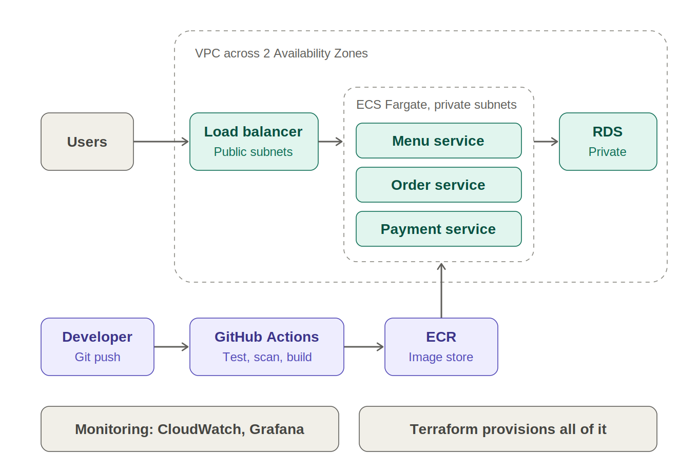

# CloudNest

**A DevSecOps microservices platform on AWS: three containerised services behind one load balancer, a private database, infrastructure as code, and an automated build-scan-deploy pipeline.**

Final year project, Cloud Computing. Built by YOUR NAME HERE.



## What it is

CloudNest is an online food ordering backend, used as a realistic workload to show how modern cloud systems are built and operated. The application is deliberately small. The focus is the cloud engineering around it: networking, containers, infrastructure as code, automated delivery, security, monitoring and cost control.

## Highlights

- **Three microservices** (menu, order, payment), each in its own container, image repository and security group.
- **Everything is code.** The whole AWS environment is created with Terraform.
- **One public address.** An Application Load Balancer routes by path: `/orders` to the order service, `/pay` to the payment service, everything else to the menu service.
- **Private data tier.** PostgreSQL on RDS sits in private subnets, is encrypted, and accepts connections only from the order service.
- **No passwords in code.** The database password is generated and stored by AWS Secrets Manager, and injected into the container at start.
- **CI/CD with a security gate.** GitHub Actions builds each image, scans it, blocks any Critical finding, and only then publishes it and redeploys running services.
- **No stored cloud keys.** GitHub logs in to AWS with short-lived OIDC tokens and a least-privilege role.
- **Monitoring.** A CloudWatch dashboard and alarms email me through SNS when something is wrong.
- **Cost control.** One switch (`enable_paid`) creates or removes every hourly-billed resource.

## Technology

| Area | Technology |
|---|---|
| Cloud | AWS (ap-south-1, Mumbai) |
| Network | VPC, public and private subnets, internet gateway, route tables, security groups |
| Compute | ECS Fargate |
| Entry point | Application Load Balancer with path-based routing and health checks |
| Data | RDS PostgreSQL 16, Secrets Manager |
| Containers | Docker, Amazon ECR (scan on push) |
| Infrastructure as code | Terraform |
| CI/CD | GitHub Actions with OIDC |
| Monitoring | CloudWatch dashboard and alarms, SNS email |
| Application | Python, Flask, Gunicorn |

## Services

| Service | Endpoints |
|---|---|
| Menu | `GET /menu`, `GET /menu/<id>`, `GET /health` |
| Order | `POST /orders`, `GET /orders`, `GET /health`, `GET /health/db` |
| Payment | `POST /pay` (simulated: approves amounts up to 5000, declines above), `GET /health` |

## Repository layout

```
app/                    service code and Dockerfiles (menu, order, payment)
terraform/              all AWS infrastructure
docs/                   full documentation, diagrams, screenshots, daily notes
.github/workflows/      CI/CD pipeline
```

Full documentation, design decisions, security notes, cost notes and a daily log are in [docs/docs.md](docs/docs.md).

## How the pipeline works

On every push to `main` that changes app code or the workflow:

1. The three images are built in parallel.
2. Each is pushed to ECR tagged with the commit ID.
3. The pipeline waits for the ECR scan. **Any Critical finding fails the build.** High findings only raise a warning.
4. Only after the scan passes is the image published as `latest`.
5. Services that are running are redeployed. Services that are not running are skipped.

## Run it yourself

Requires an AWS account, Terraform, the AWS CLI, Docker and Git. Commands are shown for PowerShell.

```
git clone https://github.com/officialshreyas19-source/cloudnest.git
cd cloudnest/terraform

# your alert email stays local (terraform.tfvars is git-ignored)
Set-Content terraform.tfvars 'alert_email = "you@example.com"'

terraform init
terraform apply                              # free resources only
```

Confirm the subscription email that AWS sends, otherwise no alarm email will arrive. If you fork this repository, set the `github_repo` variable to your own `owner/name`, and store the pipeline role address as a GitHub Actions variable named `AWS_ROLE_ARN` (the `github_actions_role_arn` Terraform output). Push to `main` so the pipeline publishes the three images, then start the paid resources, test and switch them off:

```
terraform apply -var="enable_paid=true"      # starts billing, about 6 minutes for the database

$alb = terraform output -raw alb_dns_name
Invoke-RestMethod "http://$alb/menu"
Invoke-RestMethod -Method Post -Uri "http://$alb/orders" -ContentType "application/json" -Body '{"item_id":1,"quantity":2}'
Invoke-RestMethod -Method Post -Uri "http://$alb/pay" -ContentType "application/json" -Body '{"order_id":1,"amount":249}'

terraform apply -var="enable_paid=false"     # removes every hourly-billed resource
```

## Cost

The always-on parts (network, registry, cluster, security groups, alert topic) are free or very cheap. The load balancer, database, tasks, dashboard and alarms exist only while `enable_paid` is true, so a test session costs a small amount. Check current AWS pricing before running it, and always switch the paid resources off afterwards.

## Security

- MFA on the root and admin users, and daily work done as an IAM user.
- Services and database in a private design: the database is not publicly accessible and only the order service can reach it.
- Containers accept traffic only from the load balancer.
- Database storage is encrypted, and the password never appears in code, Git or Terraform files.
- The pipeline authenticates with OIDC and a role limited to this repository's `main` branch and to the three ECR repositories and one ECS cluster.
- Container images are scanned on push, and the pipeline blocks Critical findings. The current images show High findings in Debian base image packages (glibc, zlib) that have no fix available yet. They are documented, and a rebuild picks up fixes when Debian publishes them.

## Known limitations

These are deliberate cost or scope decisions, listed honestly:

- One container per service, so replacing a failed container causes a short gap. Production would run two or more across zones.
- Containers run in public subnets with public IPs (no NAT Gateway, which costs money every hour). Their security groups still allow only the load balancer.
- The load balancer serves HTTP only. Production would add HTTPS with a certificate and a domain.
- The database is single-zone.
- Terraform state is stored locally. A team setup would use remote state with locking.
- The payment service is a simulation.
- No autoscaling.

## What I would build next

HTTPS with ACM and Route 53, private subnets with VPC endpoints instead of public IPs, autoscaling, remote Terraform state, a WAF in front of the load balancer, and scheduled image rebuilds.